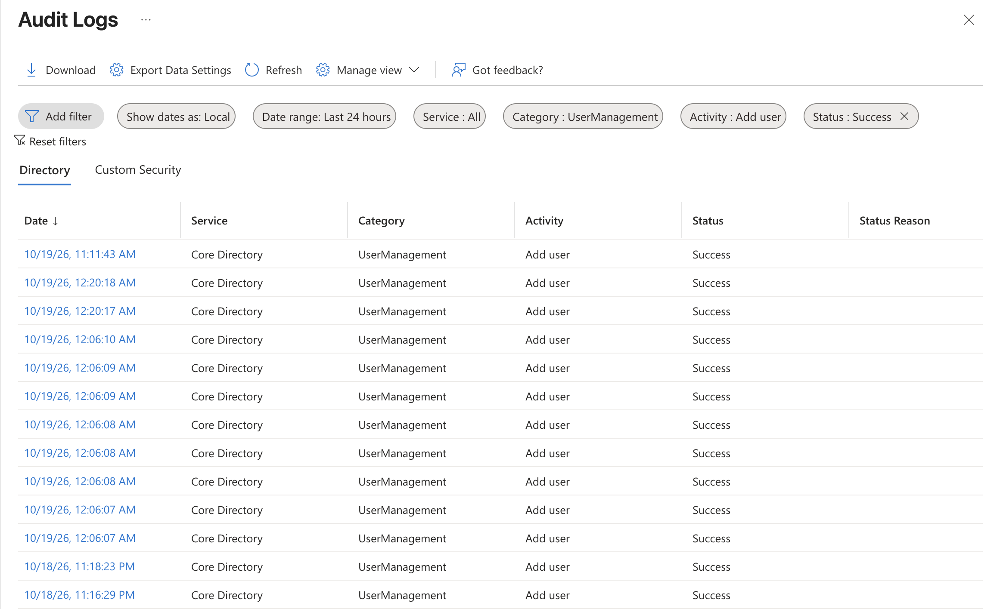

# northwind-entra-iam-lab
Microsoft Entra ID lab for Zero to Sec Academy: directory setup, user management, and security groups.

## Adding the Sixteenth Northwind User

I created Isabella Moore as an Account Executive in the Sales department,
reporting to Ethan Wilson, with United States as her usage location.
I then added her to SEC-Dept-Sales.

This required two administrative tasks:
1. Create the user account.
2. Add the user to the Sales group.

Sales now has five members. The directory contains 16 Northwind users
plus my lab administrator account, for 17 accounts total.

## Group-Based vs. Individual Application Assignments

This is a hypothetical design comparison. No application access has
been configured in this lab.

The five Sales users would each need:
- Salesforce for customer relationship management.
- SAP Concur for expense reporting.
- DocuSign for electronic signatures.
- Slack for team communication.

With group-based assignments, SEC-Dept-Sales would be assigned to each
application once: 4 application assignments total. After those assignments
were configured, onboarding a salesperson would require two tasks:
create the account and add it to the Sales group.

With individual assignments, each of the five salespeople would need
four application assignments: 5 × 4 = 20 assignments total.
Onboarding a salesperson would require five tasks: create the account
and make four application assignments.

The comparison is 4 group-to-application assignments versus 20
user-to-application assignments for the same intended access.
These totals exclude account creation and group memberships.

Group-based application assignment requires Microsoft Entra ID P1 or P2.
It was not implemented in this free-tier lab.

## Audit Log Evidence

The screenshot shows filtered audit log entries for my lab administrator's
directory changes, including timestamps, activities, targets, and status.

